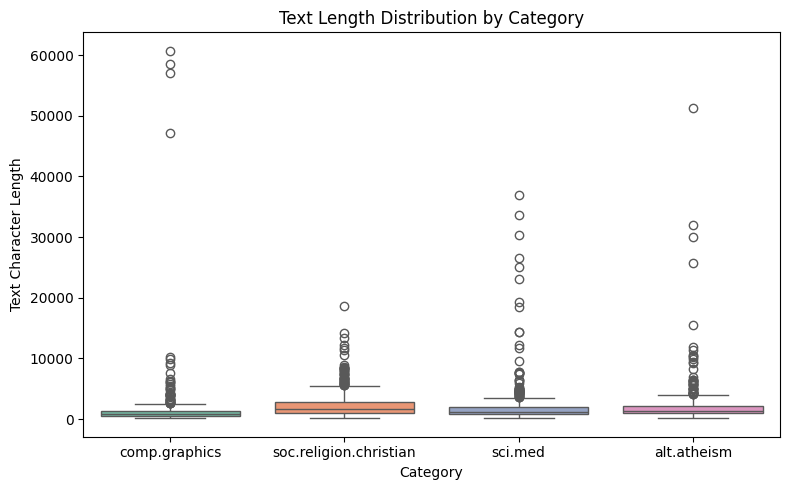
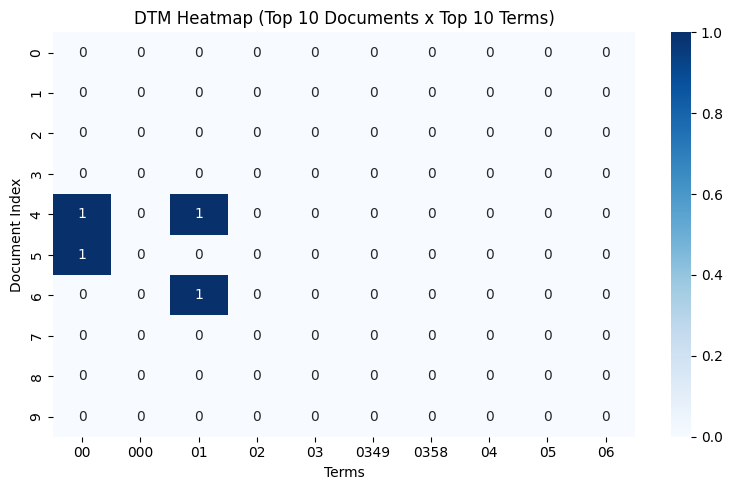
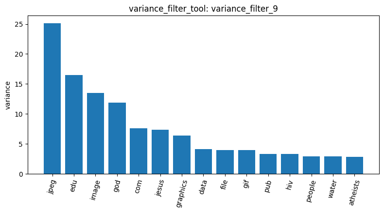
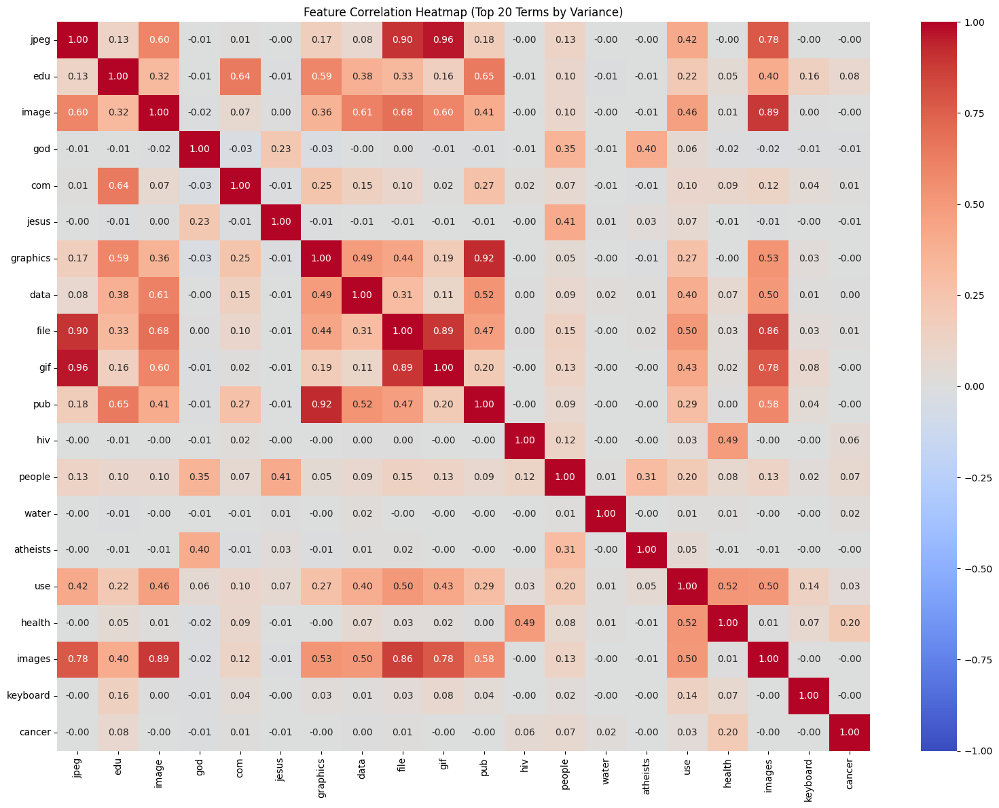
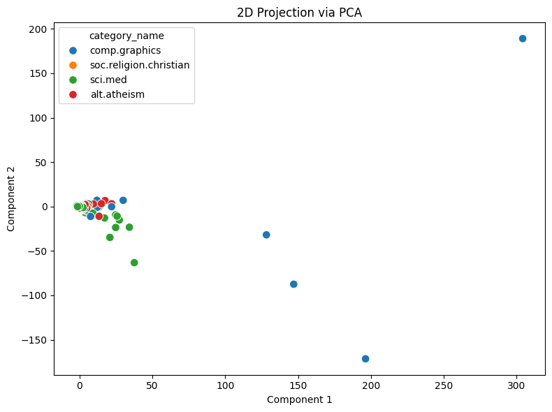
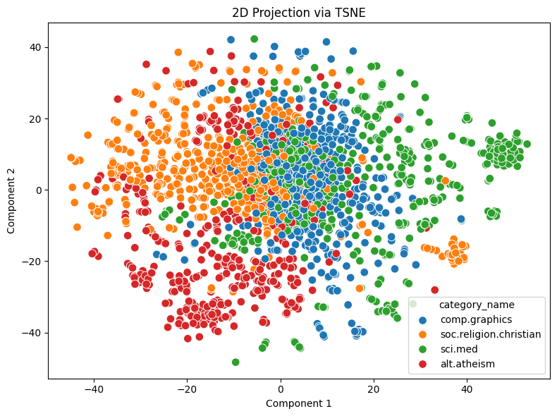

# Lab 1 Agentic Pipeline Analysis Report

**Student Name:** 沈劭丞  
**Student ID:** 115062644  
**Track:** agentic-pipeline  

## 1. Dataset Overview and Text Exploration
In this pipeline, we analyzed the 20-newsgroups dataset restricted to four distinct thematic categories: `alt.atheism`, `soc.religion.christian`, `comp.graphics`, and `sci.med`. Following dataset loading via `load_dataset_tool`, data quality checks confirmed no null or missing records (`check_missing_tool`). To examine textual characteristics across categories, we computed text length distributions using `describe_data_tool` (`result_id: describe_data_5`). The distributions reveal that while all four categories share a comparable median length around 1,000 to 2,000 characters, there is substantial right-skewness and extreme outliers reaching over 30,000–60,000 characters, especially in `comp.graphics` and discussion threads in religion.

## 2. Document-Term Matrix and Matrix Sparsity
We converted the collection of documents into a document-term matrix (DTM) with English stop-word removal and minimum document frequency filtering using `build_dtm_tool`. To investigate the structure of the resulting representation, we examined a slice of top documents and terms via `dtm_heatmap_tool` (`result_id: dtm_heatmap_8`). The resulting heatmap illustrates the acute sparsity inherent in bag-of-words text representations, where the vast majority of term occurrences in any given document are zero. This highlighted the necessity of variance filtering and feature selection before downstream modeling.

## 3. Feature Selection, Variance Filtering, and Correlation Clustering
To filter out near-constant, uninformative terms, we applied variance filtering using `variance_filter_tool` (`result_id: variance_filter_9`). Using `visualize_result_tool` (`plot: 沈劭丞_agentic-pipeline_plot_turn80.png`), we visualized the terms with the highest variance across documents, identifying domain-salient tokens such as `jpeg`, `edu`, `image`, `god`, `jesus`, `graphics`, `file`, and `gif`. 

Subsequently, we evaluated inter-term dependencies among the top variance features using `feature_correlation_matrix_tool` (`result_id: feature_correlation_11`). The correlation heatmap clearly demonstrates modular thematic clustering: graphics terms (`jpeg`, `image`, `file`, `gif`, `graphics`) show strong positive mutual correlations ranging from 0.60 to 0.96; religious terms (`god`, `jesus`, `atheists`) form a correlated cluster; and biomedical terms (`hiv`, `health`, `cancer`) correlate together. This confirms that unsupervised variance filtering effectively preserved the core semantic vocabulary characterizing each newsgroup.

## 4. Dimensionality Reduction and Semantic Manifolds
Finally, we projected the high-dimensional document-term matrix into two-dimensional space using both linear and non-linear reduction techniques via `reduce_dimensions_tool`. The linear PCA projection (`result_id: reduce_dimensions_12`) shows that the primary principal components are heavily influenced by a few extreme outlier documents (primarily in `comp.graphics`), causing most documents to cluster tightly near the origin.

In contrast, the non-linear t-SNE projection (`result_id: reduce_dimensions_13`) successfully disentangles the global structure into coherent semantic clusters. Documents belonging to `comp.graphics` (blue) and `sci.med` (green) form well-isolated clusters corresponding to technical and medical discussions. Meanwhile, `alt.atheism` (red) and `soc.religion.christian` (orange) exhibit adjacent and partially overlapping manifolds, accurately reflecting the shared theological vocabulary and cross-posting debate dynamics between these two communities.

