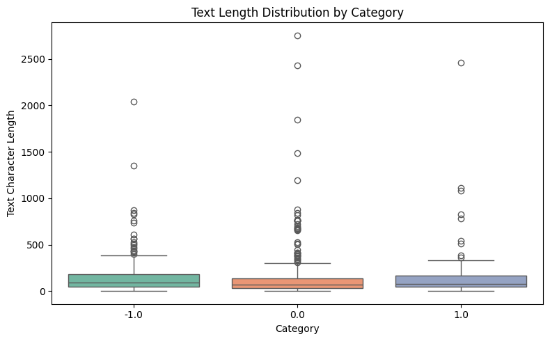
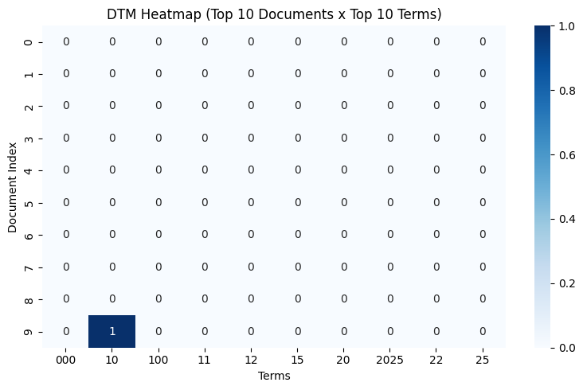
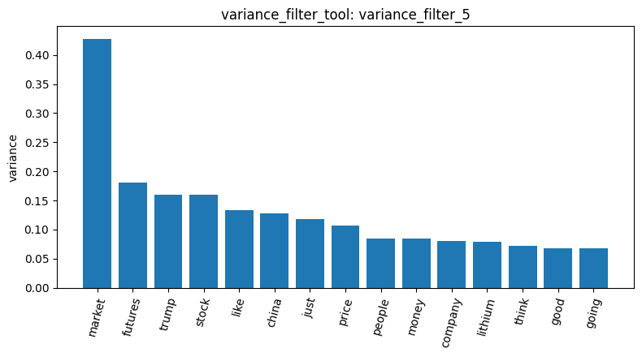
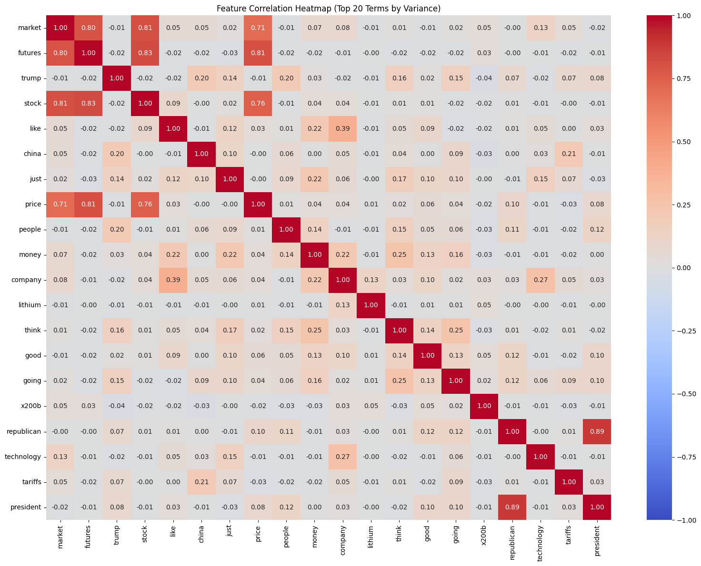
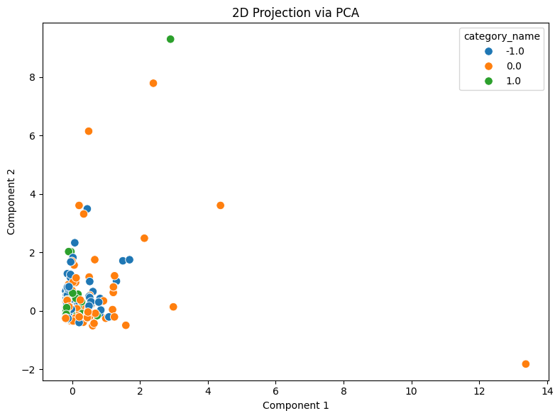
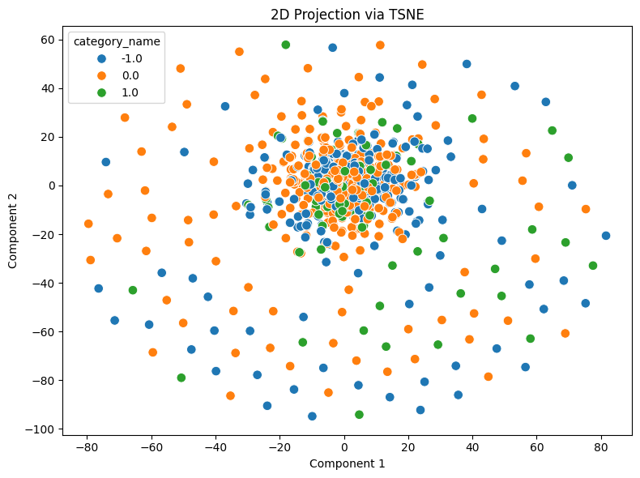

# Lab 1 Homework Analysis Report

**Student Name:** 沈劭丞  
**Student ID:** 115062644  
**Track:** homework  

## 1. Dataset Overview and Sentiment Text Exploration
In this homework pipeline, we analyzed the Reddit financial sentiment dataset (`newdataset/Reddit-stock-sentiment.csv`) comprising 847 social media posts and comments labeled across three sentiment classes: neutral (`0.0`, 423 records, 49.9%), negative (`-1.0`, 315 records, 37.2%), and positive (`1.0`, 109 records, 12.9%). Following dataset ingestion via `load_dataset_tool`, text length distributions across sentiment classes were examined using `describe_data_tool` (`result_id: describe_data_2`). Across all three sentiment classes, the text length distributions exhibit severe right-skewness: while the median comment lengths remain relatively short (96 characters for negative, 68 for neutral, and 82 for positive), mean lengths range from 140.8 to 164.6 characters with extreme outlier posts exceeding 2,000 to 2,750 characters in detailed investment due diligence posts.

## 2. Document-Term Matrix and Representation Sparsity
We converted the textual corpus into a document-term matrix (DTM) with English stop-word filtering and minimum document frequency thresholding (`min_df=3`) using `build_dtm_tool`. The resulting vector space consists of 847 documents mapped across 904 vocabulary features. To inspect the representation structure, we visualized a submatrix of the top documents and terms via `dtm_heatmap_tool` (`result_id: dtm_heatmap_4`). The resulting heatmap illustrates the extreme sparsity inherent in social media text representations, where informal comments, brief reactions, and financial jargon result in predominantly zero counts across the vast majority of term-document pairs, confirming the necessity of variance filtering before downstream analysis.

## 3. Variance Filtering and Financial Feature Correlation
To filter out near-constant, uninformative features, we evaluated term variances using `variance_filter_tool` and visualized the top features using `visualize_result_tool` (`plot: 沈劭丞_homework_plot_turn48.png`). The top-ranked variance terms highlight domain-salient financial tokens: `market` (variance ~0.428), `futures` (~0.181), `trump` (~0.161), `stock` (~0.160), `like` (~0.133), `china` (~0.127), `just` (~0.118), `price` (~0.107), `people` (~0.085), and `money` (~0.084).

Subsequently, we evaluated pairwise dependencies among these top-variance features via `feature_correlation_matrix_tool` (`result_id: feature_correlation_6`). The correlation heatmap reveals tight thematic clustering among core financial instruments and pricing metrics: `market`, `futures`, `stock`, and `price` form a dense positive correlation block, with `market` correlating strongly with `stock` (r=0.812) and `futures` (r=0.803), and `futures` correlating with `stock` at r=0.827. In addition, macroeconomic and geopolitical terms (`trump` and `china`, r=0.200) form an identifiable co-occurrence pair, while casual sentiment tokens (`like`, `just`, `money`) cluster together, confirming that the unsupervised pipeline successfully extracts modular semantic dynamics from informal Reddit discourse.

## 4. Dimensionality Reduction and Sentiment Manifold Interpretation
Finally, we projected the high-dimensional document-term matrix into two-dimensional space using both linear and non-linear techniques via `reduce_dimensions_tool`. The linear PCA projection (`result_id: reduce_dimensions_7`) shows that the primary principal components are dominated by a handful of lengthy, highly active outlier posts, causing the overwhelming majority of short comments to cluster tightly around the coordinate origin.

In contrast, the non-linear t-SNE projection (`result_id: reduce_dimensions_8`) unfolds the manifold structure and reveals distributed community clusters. Notably, unlike the 20-newsgroups dataset where distinct thematic domains (such as computer graphics vs. religion) separated into isolated islands, the three sentiment classes (`-1.0`, `0.0`, `1.0`) on Reddit exhibit extensive spatial overlap and intertwined boundaries. This highlights a fundamental distinction in text mining: financial market sentiment relies heavily on shared contextual vocabulary (`market`, `stock`, `calls`, `puts`, `price`), where positive and negative stances are separated by subtle syntactic sentiment nuances rather than disjoint lexical vocabularies.

